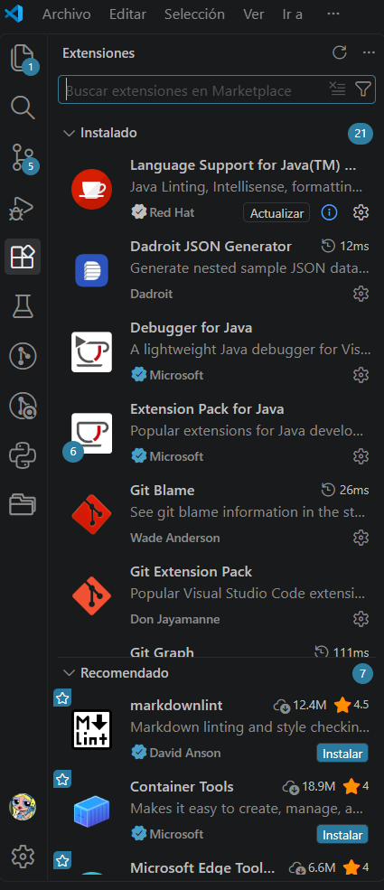
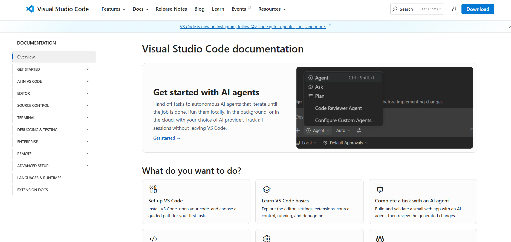
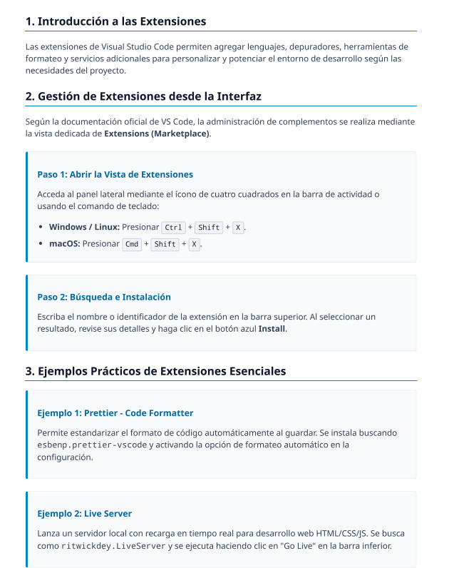

 # INFORME TÉCNICO: INTERPRETACIÓN DE DOCUMENTACIÓN Y CONFIGURACIÓN EN VS CODE

## INTRODUCCIÓN
Para el desarrollo de la actividad se seleccionó la sección "Extensions" de la documentación oficial de Visual Studio Code.

## ANÁLISIS COMPARATIVO: IA VS. DOCUMENTACIÓN OFICIAL
Presenta el tema, explica por qué es importante y señala el objetivo del trabajo.

## Puntos de Similitud

**Objetivo de Extensibilidad:** Ambas fuentes coinciden en que las extensiones transforman a VS Code en un entorno de desarrollo integrado (IDE) potente y adaptable sin recargar la aplicación base.

**Estandarización y Buenas Prácticas:** Coinciden en la importancia de la configuración modular y en el uso de identificadores únicos (Extension ID en formato publicador.nombre-extension)[cite: 4] para gestionar y recomendar herramientas.

## Diferencias Fundamentales

**Nivel de Aplicación y Alcance:** La guía de la IA ofrece un enfoque práctico enfocado en el usuario final y trabajo en equipo básico a nivel de repositorio local (archivo .vscode/extensions.json)[cite: 4]. En cambio, la documentación oficial aborda la arquitectura técnica del editor, APIs de desarrollo de extensiones y aislamiento del proceso de ejecución.

**Flujos de Trabajo Abordados:** La IA se limita a extensiones esenciales de desarrollo front-end y formato de código (Prettier, Live Server)[cite: 3], mientras que la documentación oficial se orienta a infraestructura, desarrollo en la nube (Azure) y entornos contenerizados.

## EJEMPLO PRACTICO

**EXTENSIONES**

> []

## CONCLUSIONES

1. La guía de la IA sintetiza de forma clara y accesible los pasos operativos cotidianos para gestionar extensiones y configurar proyectos colaborativos en equipo.   

2. La documentación oficial es la fuente de referencia necesaria para comprender la arquitectura interna, garantizar la seguridad del runtime y desplegar entornos de desarrollo avanzados en la nube.

**DOCUMENTACIÓN OFICIAL**

**INFORME IA**

